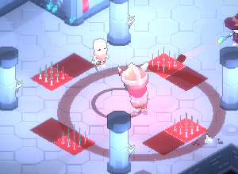
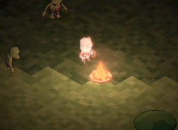
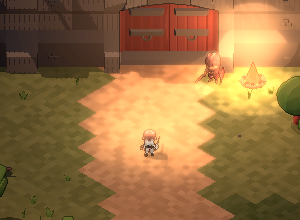

# Dungeonlock

*Not everything unlocks.*

A torchlit, isometric pixel-art action game that runs in the browser. You can fight down through a dungeon, survive nights on a wild island, or play a short story as a village swordsmith. It is built with plain JavaScript and three.js, with no build step.

**Play:** [dungeonlock.pages.dev](https://dungeonlock.pages.dev) (mirror: [play.dungeonlock.workers.dev](https://play.dungeonlock.workers.dev))
**Wiki:** [dungeonwiki.pages.dev](https://dungeonwiki.pages.dev)

It works with a keyboard and mouse, with a controller, or on a phone held sideways.

## Three ways to play

<table>
<tr>
<td width="33%"></td>
<td width="33%"></td>
<td width="33%"></td>
</tr>
<tr>
<td valign="top"><b>The Dungeon</b><br>Start in the Keep, pick one of five classes (Knight, Rogue, Wizard, Barbarian, Necromancer) and one of their three weapons, and descend. Five patrons offer boons for your moves. A boss waits at depth 9, and the Lock after it needs a key. Below the first Lock the dungeon floods into the Sunken Vaults, ruled by the Drowned King. Elites carry affixes. Ash from each run buys lasting upgrades and new weapons, and Feats pay out more.</td>
<td valign="top"><b>The Wilds</b> (beta)<br>A huge island of meadow, forest, rock and lakes. Gather wood, stone and fiber by day and craft campfires, torches, barricades, spike traps, stew and more. When night falls, the dead rise.</td>
<td valign="top"><b>Adventure</b><br>Six chapters as a village swordsmith with no magic, only one sword. Go from your forge, down the King's Road and into the castle to fight the Black Knight and rescue the princess. Each chapter start is saved.</td>
</tr>
</table>

New players can start with the **Tutorial** card on the Play menu. It teaches the moves in one quiet room.

## Controls

| Move | Keyboard and mouse | Controller | Phone |
|---|---|---|---|
| Move | WASD or arrows | Left stick | Drag on the left half |
| Aim | Mouse | Right stick | Turns to the nearest foe |
| Attack | Left click or J | X | ATTACK |
| Special | Right click or K | Y | SPECIAL |
| Cast | Q or L | B | CAST |
| Dash | Space or Shift | A | DASH |
| Use | E | RB | USE |
| Craft (Wilds) | Tab or C | View | CRAFT |
| Pause | Esc | Start | II |

You can rebind keys and buttons in Settings. Settings can also export your progress to a file and import it back.

Finding it easy? Turn on **Hardcore** in Settings. Enemies get 50% more health and hit 50% harder, elites show up more often, and your Anvil upgrades stay switched off.

## Run it locally

You need [Node.js](https://nodejs.org). Nothing else has to be installed.

```bash
node serve.js
```

Then open http://localhost:5173. On Windows you can double-click `start.bat` instead. The game must be served from a local server rather than opened as a file, because ES modules and gamepads don't work from `file://`.

## Project layout

```
index.html        page, HUD and menu styles
src/
  main.js         game loop, states and menus
  render.js       low-res render, outlines, toon lighting, camera
  input.js        keyboard, mouse and controller
  touch.js        on-screen phone controls
  keep.js         the Keep between runs: Maren, Rattle and what they say
  feats.js        Feats: one-time goals that pay ash
  classes.js      the five classes, their weapons, and the Swordsmith
  enemies.js      every enemy and boss, and their AI
  combat.js       hits, projectiles, telegraphs and effects
  boons.js        patrons and boons
  room.js, run.js dungeon rooms, layouts, runs and saves
  wild.js         the Wilds: island, day and night, crafting
  adventure.js    Adventure chapters and the forge
  codex.js        in-game Codex, also used to build the wiki
  save.js         save file export and import
assets/           KayKit and Quaternius models, music, and screenshots for the menus
wiki/             the wiki site (generated from src/codex.js)
test/             browser test harness and screenshot tools
```

## Tests

The tests drive the real game in the browser with a fake controller, stepping it at 60 frames a second. They run with sound muted. With the local server running, open the browser console on http://localhost:5173 and run:

```js
const T = await import('/test/harness.js');
await T.smoke();          // a run with each class
await T.bestiary();       // every enemy acts and dies
await T.tutorial();
await T.wilds();
await T.adventure();
await T.touchControls();  // the phone controls
await T.hardcore();
await T.keep();           // the Keep between runs
await T.feats();
await T.gale();           // the fifth patron's Shock
await T.crafts();         // the Wilds' newer recipes
await T.allies();         // the Necromancer's raised dead
await T.saves();
await T.settingsCheck();
```

Each test returns a list of `PASS` and `FAIL` lines.

To rebuild the wiki after changing game data, run `await (await import('/test/shots.js')).buildWiki()` in the same console.

## Deploying

```bash
node build.js
```

This copies only `index.html`, `src/` and `assets/` into `dist/`. Tests and tools stay out. Serve `dist/` from any static host. The live game runs on Cloudflare Pages and Workers, and the wiki is the `wiki/` folder.

## Credits

- Characters, dungeon, forest and medieval pieces: [KayKit](https://kaylousberg.com) by Kay Lousberg (CC0)
- Zombies: [Quaternius](https://quaternius.com) (CC0)
- Music, all CC0 from [OpenGameArt](https://opengameart.org): "Dungeon Ambience" by yd, "Heavy Dungeon" by MintoDog, "Dark Cavern Ambient" by Paul Wortmann, "Dark Shrine Loop" by qubodup, "Dark Forest Theme" by cynicmusic, and "Medieval: The Bard's Tale" by RandomMind (see `assets/music/LICENSE.txt`)
- Font: [Press Start 2P](https://fonts.google.com/specimen/Press+Start+2P) by CodeMan38 (OFL)
- Rendering: [three.js](https://threejs.org)
