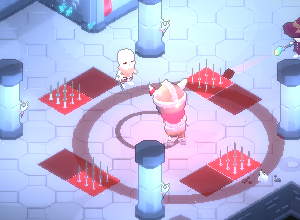

# Dungeonlock

*Not everything unlocks.*

A torchlit, isometric pixel-art action game that runs in the browser. You fight down through a dungeon alone, on the Daily Run, or with up to three friends in Co-op. It is built with plain JavaScript and three.js, with no build step.

**Play:** [dungeonlock.pages.dev](https://dungeonlock.pages.dev) (mirror: [play.dungeonlock.workers.dev](https://play.dungeonlock.workers.dev))
**Wiki:** [dungeonwiki.pages.dev](https://dungeonwiki.pages.dev)

It works with a keyboard and mouse, with a controller, or on a phone held sideways.

## How it plays



Start in the Keep, pick one of five classes (Knight, Rogue, Wizard, Barbarian, Necromancer) and one of their three weapons, and descend. Seven patrons offer boons for your moves, each with its own status: Burn, Chill, Corrode, Hex, Shock, Doom and Mark. A boss waits at depth 9, and the Lock after it needs a key. Below the first Lock the dungeon floods into the Sunken Vaults, ruled by the Drowned King. Below the second Lock the Ember Forges burn, ruled by the Forgemaster. Elites carry affixes. Spend run ash at the Peddler, strike a bargain at a Shrine, take on a Trial, or gamble on a Chest. Swear Vows in the Keep for harder runs and more ash, play the Daily Run and post your score to the shared board, or bring up to three friends in Co-op and talk in emojis. Ash from each run buys lasting upgrades and new weapons, and Feats pay out more.

New players can start with the **Tutorial** card on the Play menu. It teaches the moves in one quiet room.

## Controls

| Move | Keyboard and mouse | Controller | Phone |
|---|---|---|---|
| Move | WASD or arrows | Left stick | Drag on the left half |
| Aim | Mouse, while it moves (rest it to face the way you walk) | Right stick | Turns to the nearest foe |
| Attack | Left click or J | X | ATTACK |
| Special | Right click or K | Y | SPECIAL |
| Cast | Q or L | B | CAST |
| Dash | Space or Shift | A | DASH |
| Use | E | RB | USE |
| Pause | Esc | Start | II |

You can rebind keys and buttons in Settings. Settings can also export your progress to a file and import it back.

Finding it easy? Turn on **Hardcore** in Settings. Enemies get 50% more health and hit 50% harder, elites show up more often, and your Anvil upgrades stay switched off.

## Run it locally

You need [Node.js](https://nodejs.org). Nothing else has to be installed.

```bash
node serve.js
```

Then open http://localhost:5173. On Windows you can double-click `start.bat` instead. The game must be served from a local server rather than opened as a file, because ES modules and gamepads don't work from `file://`.

## Project layout

```
index.html        page, HUD and menu styles
src/
  main.js         game loop, states and menus
  render.js       low-res render, outlines, toon lighting, camera
  input.js        keyboard, mouse and controller
  touch.js        on-screen phone controls
  keep.js         the Keep between runs: the Anvil, the vow altar and the gate
  net.js          co-op: the relay connection, the lobby, and syncing heroes, rooms and enemies
  emote.js        quick chat: number keys to emojis over your head, names and health over other players
  feats.js        Feats: one-time goals that pay ash
  shop.js         the Peddler's wares, the Shrine's bargains and the Chest room
  classes.js      the five classes and their weapons
  enemies.js      every enemy and boss, and their AI
  combat.js       hits, projectiles, telegraphs and effects
  boons.js        patrons and boons
  room.js, run.js dungeon rooms, layouts, runs and saves
  codex.js        in-game Codex, also used to build the wiki
  save.js         save file export and import
assets/           KayKit models, music, and screenshots for the menus
wiki/             the wiki site (generated from src/codex.js)
test/             browser test harness and screenshot tools
```

## Tests

The tests drive the real game in the browser with a fake controller, stepping it at 60 frames a second. They run with sound muted. With the local server running, open the browser console on http://localhost:5173 and run:

```js
const T = await import('/test/harness.js');
await T.smoke();          // a run with each class
await T.bestiary();       // every enemy acts and dies
await T.tutorial();
await T.touchControls();  // the phone controls
await T.hardcore();
await T.keep();           // the Keep between runs
await T.feats();
await T.gale();           // the fifth patron's Shock
await T.allies();         // the Necromancer's raised dead
await T.shop();           // the Peddler
await T.shrine();         // a Shrine's bargain
await T.dodge();          // perfect dodges
await T.patrons();        // Knell's Doom, Vigil's Mark, the boon screens, and patron doors
await T.rooms();          // door signs, Trials, Chests and the Ember Forges
await T.saves();
await T.settingsCheck();
```

Each test returns a list of `PASS` and `FAIL` lines.

To rebuild the wiki after changing game data, run `await (await import('/test/shots.js')).buildWiki()` in the same console.

## Co-op

The Co-op card runs a Dungeon run for up to four players. In the lobby each player sets a name, a color, an emoji icon, a class and a weapon, and everyone in the room sees them. `server/relay.js` is a Cloudflare Worker at wss://dungeonrelay.dungeonlock.workers.dev with one Durable Object per four-letter room code; it only passes messages along. The host's game runs the rooms and the enemies, every player runs their own hero, and hits travel both ways. Quick chat (number keys, or the speech bubble on a phone) sends emojis to everyone.

## The daily leaderboard

`server/scores.js` is a Cloudflare Worker at https://dungeonscores.dungeonlock.workers.dev with a D1 database (`dungeonscores`). `GET /daily` returns today's top ten; `POST /daily` keeps each name's best score for the day. It only checks that a score is within sane bounds, so it is a casual board, not a cheat-proof one.

## Deploying

```bash
node build.js
```

This copies only `index.html`, `src/` and `assets/` into `dist/`. Tests and tools stay out. Serve `dist/` from any static host. The live game runs on Cloudflare Pages and Workers, and the wiki is the `wiki/` folder.

## Credits

- Characters, dungeon pieces and the Keep's weapon rack: [KayKit](https://kaylousberg.com) by Kay Lousberg (CC0)
- Music, all CC0 from [OpenGameArt](https://opengameart.org): "Dungeon Ambience" by yd, "Heavy Dungeon" by MintoDog, "Dark Cavern Ambient" by Paul Wortmann, and "Dark Shrine Loop" by qubodup (see `assets/music/LICENSE.txt`)
- Font: [Press Start 2P](https://fonts.google.com/specimen/Press+Start+2P) by CodeMan38 (OFL)
- Rendering: [three.js](https://threejs.org)
